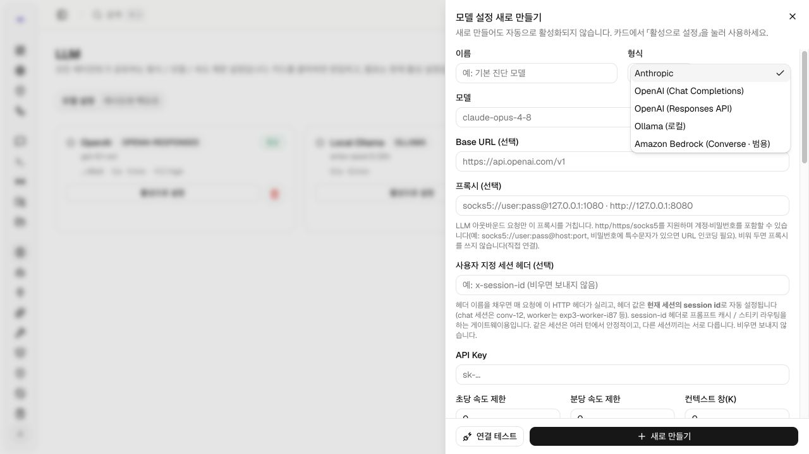
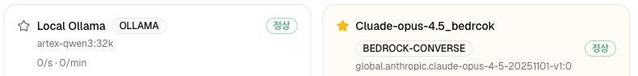
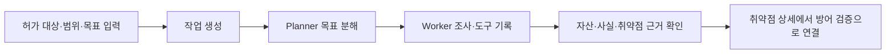
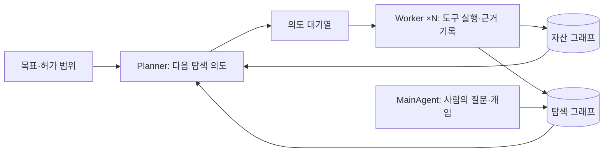
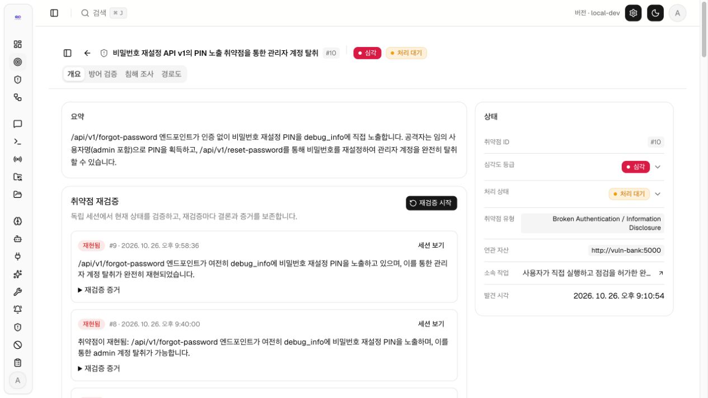
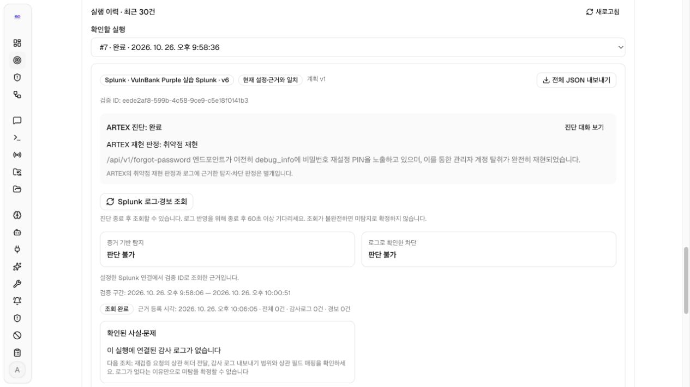
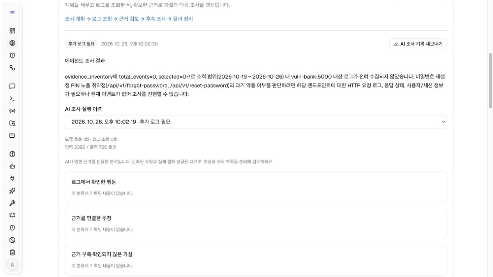
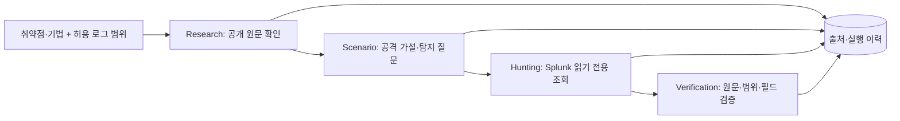
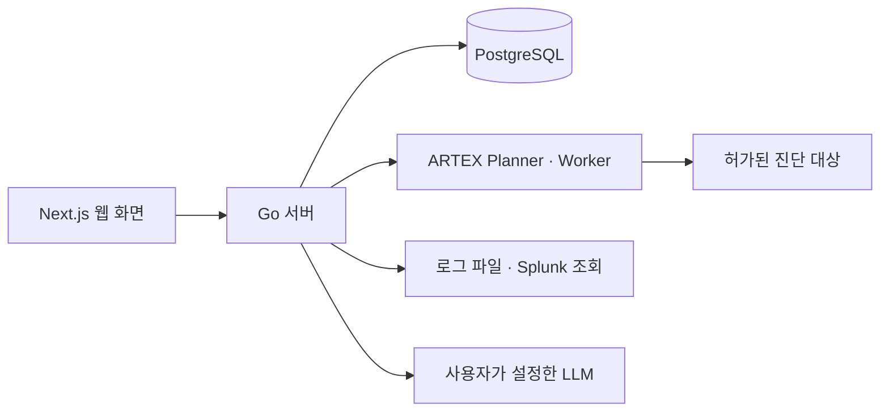

<div align="center">

# AegisLoop : ARTEX-KO Plus

**취약점 발견부터 방어 검증·침해 조사·자율헌팅까지**

[](LICENSE)

[화면으로 보기](#실제-화면으로-보는-조사-흐름) · [자율헌팅](#defensive-자율헌팅) · [빠른 시작](#빠른-시작) · [사용 설명서](docs/FINDING_DEFENSE_INVESTIGATION_KO.md)

</div>

AegisLoop는 [ARTEX](https://github.com/Autumn-27/ARTEX)의 [한국어판 artex-ko](https://github.com/jiwoochris/artex-ko)를 기반으로 한 보안 검증 프로젝트입니다. 허가된 자산에서 찾은 취약점을 출발점으로 공격·탐지 시나리오를 설계하고, 실제 실행 로그로 탐지·차단 여부를 검증하며, 과거 로그에서 관련 행동을 조사합니다. 별도의 Defensive 자율헌팅은 입력한 취약점·공격 기법을 조사하고 허용한 Splunk 로그에서 관련 근거를 찾습니다.

## 모델 선택 (기존 환경에서 Ollama, AWS Bedrock 호출 기능 확장)

**시스템 → LLM → 새 프로필**에서 모델 연결을 직접 선택할 수 있습니다. 화면에서 제공하는 형식은 **Anthropic**, **OpenAI (Chat Completions)**, **OpenAI (Responses API)**, **Ollama**, **Amazon Bedrock Converse**입니다. 프로필마다 모델 ID와 연결 주소를 지정할 수 있으며, 여러 프로필을 저장해 작업의 **LLM 설정 체인**에서 선택할 수도 있습니다.  
  
선택 가능 모델
-  Antropic
-  OpenAI
-  Ollama 로컬 모델
-  AWS Bedrock 모델




아래는 로컬 환경에 **이미 저장된** Ollama와 Amazon Bedrock Converse 프로필의 화면입니다. 두 프로필 모두 캡처 시점에 `정상`으로 표시됐으며, Bedrock의 경우에는 opus, Ollama는 qwen, deepseek-rl으로 호출 및 진단을 수행하였습니다. ollama는 컴퓨팅 한계로 9B정도의 모델로 수행하여 정확한 진단이 어려웠지만, Bedrock은 취약점을 잘 찾는 것을 확인할 수 있었습니다.



1. 형식을 고르고 프로필 이름, 사용할 **모델 ID**, 해당 공급자의 연결 주소와 인증 정보를 입력합니다. Ollama는 API 키가 필요하지 않으며, Docker에서 호스트의 Ollama에 연결할 때는 기본 URL로 `http://host.docker.internal:11434/v1`을 사용합니다.
2. **연결 테스트**로 실제 응답을 확인한 다음 저장하고, 전역에서 사용할 프로필은 **활성으로 설정**합니다. 작업에 LLM 설정 체인을 지정했다면 그 작업의 선택을 별도로 확인합니다.
3. Bedrock은 **Amazon Bedrock Converse**를 선택하고 해당 리전의 Runtime URL(예: `https://bedrock-runtime.ap-northeast-2.amazonaws.com`), 계정에서 사용할 수 있는 모델 ID 또는 추론 프로필 ID/ARN, **Amazon Bedrock API 키**를 입력합니다. 모델 목록은 자동 조회하지 않습니다. 모델의 직접 호출이 on-demand를 지원하지 않으면 AWS가 요구하는 추론 프로필 ID/ARN을 사용해야 합니다. 특정 모델 계열로 고정되지 않으며, 실제 Converse 지원 여부와 호출 권한은 연결 테스트에서 확인합니다.

API 키, 계정별 ARN, 실제 요청·응답에 포함된 민감 정보는 README·증적·Git 기록에 넣지 마세요. 진단과 AI 기능의 응답 품질·언어·사용량은 등록한 모델에 따라 달라집니다. 작업 목표에 원하는 출력 언어를 명시하고 생성된 시나리오와 조사 결과를 원본 근거와 대조하세요. AI 침해 조사를 시작하면 선택한 취약점 근거와 로그 발췌가 설정한 모델 공급자에게 전송될 수 있습니다.

이번 공개 소스의 빌드·테스트·비밀값 제외 확인 범위는 [배포 검증 증적](docs/RELEASE_EVIDENCE_KO.md)에 기록했습니다.

```text
Offensive: 취약점과 재현 근거
    ↓
Defensive: 공격·탐지 시나리오 → 방어 계획 → 실제 로그 기반 방어 검증
    ↓
침해 조사: 로그 근거 준비 → AI 조사 → 관측 결과와 원본 근거 확인

Defensive 자율헌팅: 취약점·공격 기법 입력 → 리서치 → 시나리오 설계
                 → Splunk 헌팅 → 근거 판정
```

## Offensive 진단 실행

**Offensive → 진단 현황**에서 저장된 작업·취약점 현황을 보고, 실제 진단은 **Offensive → 작업 → 새 작업**에서 시작합니다. 필수 입력은 **설명**과 **목표**입니다. 필요하면 작업 단위 자산 허용·차단 규칙, LLM 설정 체인, 작업 타임아웃을 지정합니다.

1. 왼쪽 **Offensive → 작업**을 누르고 목록 오른쪽 위 **새 작업**을 엽니다.
2. 오른쪽 입력창의 **설명**에 대상 주소와 허가 범위(예: 로컬 실습 `http://vuln-bank-target:8080`의 `/api/ai/chat/anonymous`), **목표**에 확인할 질문과 필요한 요청·응답 근거를 적습니다.
3. **작업 단위 자산 차단 / 허용 규칙 → 규칙 추가**에서 허가된 대상만 **허용**하고, **LLM 설정 체인**을 확인합니다. **고급 설정 → 작업 타임아웃(분, 선택)**에 실행 시간 상한을 입력합니다.
4. 맨 아래 **생성**을 누르면 진단이 시작됩니다. 목록에서 새 작업을 열어 **세션 → 탐색 경로 → 취약점** 순서로 진행과 근거를 확인하고, 취약점 행의 **상세**로 이동합니다.



### Offensive 엔진

[ARTEX Global README의 엔진 구조](https://github.com/jiwoochris/artex-global/blob/main/README.md#system-architecture)를 기준으로, 한 작업의 `plannerLoop`와 여러 Worker가 자산 그래프와 작업별 탐색 그래프를 공유합니다. Planner가 새 탐색 방향을 의도(intent)로 등록하면 Worker가 허가 범위에서 한 의도를 실행하고 근거를 기록합니다. 그래프 변화가 다시 Planner를 깨워 다음 방향을 판단하게 합니다.



| 구성 | 맡은 일 | 다음 단계에 남기는 것 |
|---|---|---|
| Goals | 작업 목표와 범위를 탐색 가능한 목표로 분해 | 목표·범위 |
| Planner | 그래프의 현재 근거와 진행 상태를 읽고 필요한 의도만 배정 | 의도 대기열 |
| Worker | 의도 하나를 맡아 실제 도구를 실행하고 결과를 기록 | 자산·사실·취약점과 실행 과정 |
| MainAgent | 사람이 진행 중 질문하거나 힌트를 남기는 경로 | 대화·힌트와 작업 문맥 |

자산 그래프는 발견한 대상을, 탐색 그래프는 이 작업에서 무엇을 확인했는지를 보존합니다. 실행 과정과 목표 충족 여부를 확인해야 하며, 작업 종료만으로 취약점이 증명되지는 않습니다.

작업 상세의 **세션·탐색 경로·취약점**에서 진행 과정과 근거를 검토합니다. 작업이 끝났다는 상태만으로 취약점 확인이나 진단 범위 전체의 안전성을 판단하지 않습니다. 아래 취약점 #10 화면은 현재 흐름의 대표 결과 한 건이며, 새 설치에서 자동으로 생성되는 기록은 아닙니다.

입력 예시, 실행 중 확인할 항목, 결과 판독 기준은 [Offensive 진단 가이드](docs/OFFENSIVE_DIAGNOSIS_KO.md)에 정리했습니다.

## 실제 화면으로 보는 조사 흐름

아래 이미지는 **2026년 10월 26일 격리된 VulnBank 실습**의 취약점 #10 결과를 다시 캡처한 것입니다. 새 설치에 이 진단 기록이나 Splunk 로그가 함께 설치되지는 않습니다. 실제 PIN·JWT·응답 원문은 공개 캡처에서 제외했습니다. 전체 조작 순서는 [취약점 → 방어 검증 → 침해 조사 사용 설명서](docs/FINDING_DEFENSE_INVESTIGATION_KO.md)에 있습니다.

### 1. 취약점 근거 확인

Offensive의 ARTEX 작업이 기록한 취약점에서 대상 자산, 경로, 설명과 재현 근거를 확인합니다. 이 정보가 방어 시나리오의 입력입니다. 작업 완료나 후보 발견만으로 악용 성공을 확정하지 않습니다.



### 2. 방어 검증

**AI 시나리오 생성**은 취약점 근거로 공격 흐름과 구간별 탐지 설계를 만듭니다. 이 단계에는 Splunk 연결이 필요하지 않습니다. 각 구간에서 장비 후보, 필요한 로그·필드, 탐지 조건과 Splunk SPL **초안**을 검토한 뒤 필요한 내용을 방어 계획에 복사해 저장합니다. 장비가 실제 배치됐는지, 로그가 연동됐는지는 실제 환경에서 확인해야 합니다.

다음으로 허가된 범위에서 ARTEX 재검증을 실행하고, 해당 실행의 감사·경보 로그를 파일 또는 Splunk로 연결합니다. 화면은 **취약점 재현**, **증거 기반 탐지**, **로그로 확인한 차단**을 각각 표시합니다. SPL 초안은 자동으로 실행하거나 SIEM 정책으로 배포하지 않습니다.



이 실습에서 재진단은 취약점을 재현했지만, 연결된 감사로그와 경보가 각각 0건이어서 탐지·차단은 **판단 불가**입니다. 취약점 재현을 방어 실패나 탐지 성공으로 해석하지 않습니다.

### 3. 침해 조사

**로그 근거 준비 → AI 조사 → 결과 확인** 순서로 진행합니다. 먼저 파일을 등록하거나 저장된 Splunk 연결에서 대상·기간·경로와 인덱스 범위를 지정해 과거 로그를 조회합니다. 준비된 근거를 확인한 뒤 AI 조사를 명시적으로 시작합니다. 결과의 관측, 추정, 미확인 항목을 나눠 읽고 인용 표시에서 원본 이벤트를 대조합니다.



저장된 7일 조회는 대상 이벤트 0건이었고 AI 조사는 **추가 로그 필요**로 종료됐습니다. 이는 과거 침해가 없었다는 증명이 아닙니다. 조사 대상과 실습 로그 수집기 대상이 다른 점도 [배포 검증 증적](docs/RELEASE_EVIDENCE_KO.md)에 구분해 기록했습니다.

## Defensive 자율헌팅

**Defensive → 자율헌팅**에서 취약점 이름·CVE·공격 기법을 입력하고, 검색 권한이 있는 Splunk 연결과 조사할 로그 유형, 대상 자산, 과거 시간 범위를 지정합니다. 실행 전 조회 범위를 확인하면 네 엔진이 **리서치 → 공격·탐지 시나리오 → Splunk 자율헌팅 → 근거 판정** 순서로 진행합니다. 상단 엔진 상태를 누르면 해당 결과 탭으로 이동할 수 있고, 실행 이력에서 결과를 다시 보거나 중지·내보내기할 수 있습니다.

자율헌팅은 취약점 상세의 **AI 시나리오 생성** 및 위 **취약점 → 방어 검증 → 침해 조사** 흐름과 별도입니다. Splunk 조회는 지정한 연결·로그 유형·자산·기간 안에서 읽기 전용으로 실행합니다.

### 자율헌팅 엔진

Offensive의 Planner·Worker 실행기와 독립된 네 단계입니다. 공개 자료의 주장, AI가 만든 가설, Splunk 원본 이벤트, 최종 판정을 각각 구분해 저장합니다.



| 엔진 | 맡은 일 | 다음 단계에 남기는 것 |
|---|---|---|
| Research | 공개 원문을 가져와 관련성과 출처·발췌 해시 확인 | 출처에 연결된 조사 주장 |
| Scenario | 출처를 바탕으로 최대 4개의 공격 가설과 탐지 질문 설계 | 필수 필드·정상 대안·판정 기준 |
| Hunting | 허용한 Splunk 연결·자산·기간·로그 유형에서 조사 | 조회 범위·원본 이벤트·근거 참조 |
| Verification | 원본 참조·허용 범위·필수 필드를 검증하고 정상 대안을 함께 표시 | 관측·미관측·자료 부족 및 남은 확인 사항 |

#### 실제 php2shell 조사 증적

아래는 **2026년 10월 24일 로컬 실습**에서 저장한 실제 LLM·Splunk 실행 화면입니다. 리서치와 시나리오는 완료됐지만 Splunk 헌팅은 실행 한도에 도달했고 근거 판정은 부분 결과입니다. 이 캡처 이후 화면의 옛 **경보·침해 조사** 진입 링크는 제거했습니다.


같은 날 저장한 별도 실행 #6에서는 공개 원문 **3건**, 가설 **4단계**, 허용 범위의 Splunk 원격 조회 **1회**를 기록했습니다. 결과는 `budget_exhausted`·`insufficient_data`였고 침해 영향은 확인되지 않았습니다. 실습 사전 조회의 `/healthz` **20건**은 정상 점검 요청일 수 있어 악용 근거로 승격하지 않았습니다. 원본 로그를 제외한 수치와 파일 해시는 [실행 가이드의 증적 기록](docs/AUTONOMOUS_HUNTING_KO.md#실제-실습-증적)에 남겼습니다.

연결 준비부터 결과 판독까지의 절차는 [자율헌팅 실행 가이드](docs/AUTONOMOUS_HUNTING_KO.md)를 참고하세요.

## 기능과 판단 기준

| 기능 | 입력과 동작 | 결과를 읽을 때 |
|---|---|---|
| ARTEX 취약점 진단 | 허가된 자산을 작업 범위로 지정하고 Planner·Worker가 조사 | 원본 요청·응답과 재현 근거를 확인 |
| 공격·탐지 시나리오 | 취약점 근거에서 AI가 단계별 공격 흐름, 장비·로그 후보, SPL 초안 생성 | 장비 배치와 로그 연동은 별도 확인 |
| 방어 검증 | ARTEX 재검증과 같은 실행의 감사·경보 파일 또는 Splunk 로그를 연결 | 재현·탐지·차단을 독립적으로 판정 |
| 침해 조사 | 지정한 자산·기간·경로의 로그를 준비하고 AI 조사 실행 | 관측·추정·자료 부족을 구분하고 원문 확인 |
| Defensive 자율헌팅 | 취약점·공격 기법과 허용한 Splunk 조회 범위에서 리서치·설계·조사·판정 | 단계별 근거 참조와 자료 부족 사유를 검토 |
| Closed-loop 평가 | 기준 실행과 개선 후 재실행의 로그·규칙 결과 비교 | 후보 규칙의 일치와 실제 SIEM 경보를 구분 |

취약점 상세의 방어 검증·침해 조사는 Splunk 없이 파일 업로드로 시작할 수 있습니다. **자율헌팅은 활성화된 Splunk 연결과 LLM 설정이 필요합니다.** Splunk 연결의 인덱스와 `sourcetype`은 조사 범위에 맞게 설정합니다. 시나리오 생성, ARTEX 진단, AI 조사와 자율헌팅은 설정한 모델을 호출하므로 비용과 실행 한도가 발생할 수 있습니다.

## 빠른 시작

Docker Desktop 또는 Docker Engine과 Docker Compose v2가 필요합니다. 소스 폴더에서 다음 명령을 실행합니다. 최초 실행에는 컨테이너 이미지와 의존성 다운로드를 위한 인터넷 연결이 필요합니다.

```sh
./scripts/local-start.sh
```

1. [http://localhost:8787/setup/](http://localhost:8787/setup/)에서 관리자 계정을 만듭니다.
2. AI 기능을 사용할 경우 **시스템 → LLM**에 본인의 모델 연결을 설정합니다.
3. 본인이 소유하거나 점검을 허가받은 자산을 등록합니다. 로그를 Splunk에서 읽으려면 **Defensive → 로그 연결**을 별도로 설정합니다.
4. 자율헌팅을 사용할 경우 [실행 가이드](docs/AUTONOMOUS_HUNTING_KO.md)에 따라 Splunk 연결과 조사 범위를 확인한 뒤 **Defensive → 자율헌팅**에서 시작합니다.

깨끗한 설치의 기본 구성은 **AegisLoop 앱과 PostgreSQL**입니다. VulnBank, Juice Shop, Splunk와 같은 실습 대상·로그 시스템은 별도로 준비합니다. 앱과 기록 프록시의 기본 포트는 각각 `127.0.0.1:8787`, `127.0.0.1:8788`입니다. 로컬 DB 비밀번호와 로그인 서명 키는 실행 스크립트가 생성하며 배포 소스에 포함되지 않습니다.

```sh
# 변경된 소스를 빌드해 다시 실행
./scripts/local-start.sh

# 앱을 중지하고 저장된 데이터는 유지
docker compose --env-file .env.local -f docker-compose.local.yml stop

# 별도 임시 DB와 모의 모델·Splunk를 이용한 통합 테스트
./scripts/local-test.sh
```

루트의 `docker-compose.yml`과 `install.sh`는 기반 프로젝트의 설치 경로입니다. 이 확장의 로컬 실행 명령은 `./scripts/local-start.sh`입니다.

## 시스템 아키텍처

Next.js 화면은 Go 서버에서 제공하며, 작업·취약점·방어 계획·조사 이력은 PostgreSQL에 저장합니다. ARTEX Planner·Worker는 허가된 작업 범위에서 진단을 수행합니다. Defensive는 저장된 취약점 근거와 실행 로그를 연결하고, 파일 또는 읽기 전용 Splunk 조회로 조사 근거를 준비합니다.



## 사용 범위와 문서

### ⚠️ 먼저 읽어 주세요 — 사용 범위와 국내법 고지

진단과 재검증은 본인이 소유하거나 명시적으로 허가받은 대상에만 실행하세요. 대상, 기간, 경로와 실행 자원 한도를 점검한 후 시작하고, 로그에 포함된 개인정보와 자격 증명을 신중히 취급하세요. 운영 환경의 탐지 규칙이나 차단 정책은 이 앱이 자동 배포하지 않습니다.

- [자율헌팅 실행 가이드](docs/AUTONOMOUS_HUNTING_KO.md): 취약점 입력부터 Splunk 조회·근거 판정까지의 절차.
- [취약점 → 방어 검증 → 침해 조사 사용 설명서](docs/FINDING_DEFENSE_INVESTIGATION_KO.md): 화면 순서, Splunk 근거 준비, 결과 판독과 캡처.
- [자율 AI 공격 방어·탐지 가이드](docs/defense-ko.md): 방어자 관점의 관측 지점과 탐지 자료.
- [Defense & Detection Guide](docs/defense-en.md): 영문 방어·탐지 자료.

## 라이선스와 면책

AegisLoop는 원본 ARTEX 및 한국어판의 저작권 표시를 유지하며 [AGPL-3.0](LICENSE)으로 배포됩니다. 소프트웨어는 보증 없이 제공됩니다. 자세한 조건은 라이선스 파일을 확인하세요.
