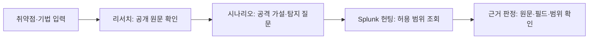

# 자율 위협 헌팅 실행 가이드

**Defensive → 자율헌팅**은 공개 동향 리포트 또는 사람이 입력한 취약점·공격 기법을 출발점으로 공개 자료를 조사하고, 공격 가설·탐지 질문을 만든 다음, 지정한 Splunk 로그에서 근거를 찾습니다. 취약점 목록이나 Offensive 진단 결과가 없어도 독립적으로 시작할 수 있습니다. 이 기능은 대상에 공격을 실행하거나 Splunk 탐지 규칙·차단 정책을 배포하지 않습니다. 기존 취약점 상세의 **방어 검증 → 침해조사** 흐름 및 **AI 시나리오 생성**과도 별도의 실행·이력입니다.

## 자동 위협 동향 리포트

로그인한 담당자는 자율헌팅 화면의 **자동 위협 동향 리포트**에서 최근 공개 신호를 검토할 수 있습니다. 서버는 시작 약 20초 뒤 첫 수집을 시도하고 이후 15분마다 CISA KEV 공개 데이터와 보안뉴스·데일리시큐·BleepingComputer·The Hacker News의 RSS/Atom 피드를 읽습니다. **지금 수집**으로 즉시 갱신할 수도 있습니다. 수집은 고정된 공개 출처에 대한 읽기 전용 요청이며, 소스별 실패를 표시하고 나머지 결과는 보존합니다.

리포트에는 제목·원문 요약·출처·발행 시각·헌팅 검토 이유를 저장합니다. CVE가 같으면 여러 매체의 링크를 하나의 리포트에 묶고, 최근 KEV 등재를 우선 표시합니다. 이 단계는 공개 피드의 메타데이터로 만드는 간단한 리포트이며, 자산 취약성이나 침해를 판정하지 않습니다. 피드 게시 지연과 수집 주기 때문에 실시간 최초 탐지를 보장하지 않습니다. 언론사 본문·유출 자료는 수집하지 않습니다.

리포트를 열 때 등록된 서비스 기술 지문과 앱 이름을 읽기 전용으로 대조합니다. KEV의 제품명이 기술 지문에 일치하거나, 기사 제목에 등록 기술명이 일치하면 **등록 자산 제품명 단서**를 표시하고 이 자산으로 헌팅 범위를 채울 수 있습니다. 일치한 원문 문자열과 자산을 함께 표시하지만 버전 범위·설정·패치 상태는 확인하지 않습니다. 자산이 일치하지 않아도 인벤토리 누락이나 기술 지문 오류가 있을 수 있으므로 안전 판정으로 해석하지 않습니다. 대조는 최근 자산 최대 5,000건으로 제한하며, 초과하면 화면에 표시합니다.

**이 리포트로 헌팅 설정**을 누르면 조사 주제와 참고 URL을 채웁니다. 제품명 단서의 **이 자산으로 설정**을 누르면 등록된 호스트·포트도 채웁니다. 담당자가 Splunk 연결·대상 자산·기간·로그 유형을 검토하고 조회 범위를 확인한 다음 기존 **자율 헌팅 시작**을 눌러야 로그 조회가 실행됩니다. 기존 수동 주제 입력도 계속 사용할 수 있습니다.

## 시작 전 준비

1. 빠른 시작에 따라 앱을 실행하고 관리자 계정으로 로그인합니다. 기본 설치에는 Splunk나 실습 로그가 포함되지 않습니다.
2. **시스템 → LLM**에서 사용할 모델 연결을 설정합니다. 자율헌팅을 시작하면 조사 주제와 선택한 범위의 로그 발췌가 설정한 모델로 전달됩니다. Splunk 인증 정보는 모델에 보내지 않습니다. 모델 호출량에 따른 비용이 발생할 수 있습니다.
3. **Defensive → 로그 연결**에서 기존 Splunk 관리 API 주소, 검색 권한이 있는 계정·토큰, 허용 인덱스와 로그 스트림의 `sourcetype`을 설정하고 연결을 활성화합니다. 앱 컨테이너에서 Splunk 관리 API에 접근할 수 있어야 합니다. 연결 테스트는 통신·인증 확인이며 로그가 충분히 수집됐다는 확인은 아닙니다.
4. 공개 자료를 자동 검색하려면 **시스템 → 설정 → 웹 검색**에서 검색 백엔드를 설정합니다. 웹 검색이 꺼져 있어도 헌팅 화면에서 공식 권고문 등의 공개 URL을 직접 지정할 수 있습니다. 공개 원문을 확보하지 못하면 시나리오 설계를 계속하지 못할 수 있습니다.

관리자 키·Splunk 암호·토큰을 조사 주제, 참고 URL 또는 이 문서의 예시에 넣지 마세요. 헌팅에 사용할 자산과 로그 범위를 먼저 확인하고, 해당 범위의 읽기 전용 조회만 승인하세요.

## 실행 순서

1. **Defensive → 자율헌팅 → 새 헌팅**을 열어 식별 가능한 이름을 입력하거나, 자동 동향 리포트를 검토하고 **이 리포트로 헌팅 설정**을 누릅니다. 예를 들어 `php2shell`을 조사한다면 정확한 CVE나 공식 권고문을 함께 확인하세요. 별칭이 여러 취약점을 가리키거나 자료에서 식별되지 않으면 해당 이름만으로 하나의 취약점을 확정하지 않습니다.
2. 필요하면 **공개 참고 URL 추가**에 인증 정보가 없는 공개 HTTP(S) 주소를 한 줄에 하나씩 넣습니다. 최대 8개입니다. 내부 시스템 주소와 비공개 자료는 입력하지 않습니다. 리서치 결과에서 실제로 가져온 출처·발췌문을 확인할 수 있습니다.
3. 활성화된 **Splunk 연결**을 선택하고 조회할 로그 유형을 고릅니다. 연결의 등록된 유형이 기본으로 모두 선택되며, 실행당 최대 8개를 사용할 수 있습니다. 선택한 연결의 허용 인덱스와 로그 유형을 벗어나 조회하지 않습니다.
4. **대상 자산**에 실제 요청 대상 호스트 또는 `호스트:포트`를 입력합니다. URL 경로는 별도 **허용 경로 접두어**에 넣습니다. 웹 요청과 호스트 이벤트를 함께 보려면 경로를 비워 둡니다. 시작·종료는 현지 시각으로 과거 구간을 지정하며, 한 실행의 기간은 최대 31일입니다.
5. **원본 로그 필드 매핑**에서 대상·경로·이벤트 ID 등의 실제 필드를 확인합니다. 특히 Splunk의 `host`가 수집기 이름이라면 대상 필드에 사용하지 말고 실제 요청 자산 필드를 지정합니다. Splunk 조회의 시각 기준은 `_time`입니다. 경로 접두어를 입력했다면 경로 필드도 필요합니다.
6. 지정한 자산·기간·로그 유형의 **읽기 전용 조회 허용**을 체크하고 **자율 헌팅 시작**을 누릅니다. 입력 범위가 바뀌면 다시 확인해야 합니다. 실행 중에는 상단의 네 엔진 상태를 눌러 결과 탭으로 이동할 수 있습니다. **중지**로 실행을 취소할 수 있고, 저장된 실행은 **헌팅 이력**에서 다시 열 수 있습니다.

## 결과 읽기

| 탭 | 확인할 내용 |
|---|---|
| **리서치** | 실제 수집한 자료의 URL·발췌문·조회 시각·SHA-256과 자료 조사 경고. 문헌이나 PoC의 주장은 해당 자산의 영향이나 악용을 증명하지 않습니다. |
| **시나리오** | 출처와 연결된 공격 **가설**, 단계별 탐지 질문, 필수 필드, 정상 활동이라는 대안, 확인 기준. 공격 실행 기록이 아닙니다. |
| **Splunk 헌팅** | 검색 범위·쿼리·수집 건수·무효·절단 건수, AI 관측과 인용 근거, 자료 공백·추가 조사. 조회 완료만으로 센서 배치나 로그 보존의 완전성이 입증되지는 않습니다. |
| **근거 판정** | 각 단계의 원본 참조, 범위와 필수 필드 검증, 정상 대안, 판정 이유와 남은 확인 사항. 인용 근거를 펼쳐 원문과 대조합니다. |

**관련 근거 관측**은 허용 범위의 원본과 필수 필드를 갖춘 활동이 관측됐다는 뜻입니다. 공격 성공이나 실제 영향을 확정하지 않습니다. **추론·추가 확인 필요**는 근거와 연결된 가설이며 정상 대안 검토가 필요합니다. **선택 범위에서 미관측**은 충분히 수집된 지정 범위에서 해당 단계 조건을 보지 못했다는 뜻일 뿐, 침해가 없었다는 결론이 아닙니다. **자료 부족**은 수집 공백, 필드 누락 또는 원본 검증 문제 등으로 판단을 보류한 상태입니다. 등록된 ARTEX 검증 표식 이벤트는 외부 침해 근거와 구분합니다.

**실행 한도 도달**, **사용자 중지**, **모델 연결 오류**, **실행 중단**이면 이미 보존된 자료와 판정만 확인할 수 있는 부분 결과입니다. 0건 또는 미관측 결과가 나오면 대상 필드, 경로, `sourcetype`, 기간, 수집 지연·보존 상태를 확인한 후 필요한 경우 새 범위로 다시 실행하세요. 자세한 원문과 수집 메타데이터는 실행의 **JSON 내보내기**에 포함되므로 공유 전에 민감 정보를 검토하세요. 화면에는 원문 발췌만 표시될 수 있습니다.

## 실제 실습 증적

2026년 10월 24일 로컬 실습에서 `php2shell`을 입력하고 실제 LLM·Splunk 연결로 조사했습니다. 대상은 격리된 `purple-lab-target:8080`, 기간은 2026년 10월 22일 09:00~09:10(한국시간)이었습니다. 아래 수치는 저장된 **실행 #6**과 같은 범위의 사전 조회 기록에서 읽은 값입니다. 화면 캡처는 같은 날의 **별도 실행 #1**이므로 실행 번호와 사용량을 혼동하지 마세요.

| 확인 항목 | 저장된 결과 |
|---|---|
| 공개 자료와 설계 | 원문 3건, 출처에 연결된 공격 가설·탐지 질문 4단계 |
| 로그 조사 | 사전 조회 `/healthz` 20건, 실행 중 Splunk 원격 조회 1회 |
| 종료와 판정 | `budget_exhausted`, 전체 판정 `insufficient_data`, 4단계 모두 자료 부족, `impact_confirmed=false` |
| 원본 무결성 | 비공개 원본 `export.json` SHA-256 `2839ad44bc5da5ec09b9db51cbe8ebc905cd5c4e8bbed3bf8cbb6c6ad2e331e2` |

보존된 이벤트 한 건의 정규화 필드는 `2026-10-22T00:09:58.053416Z · target=purple-lab-target:8080 · path=/healthz · status=200 · event_kind=audit · action=allowed`입니다. 출발지 IP와 원문은 공개하지 않았습니다. 이 이벤트는 점검 요청의 기록이지 `php2shell` 악용 증거가 아닙니다.

[실제 실행 화면](guide-images/autonomous-hunting-php2shell-20261024.jpg)은 리서치·시나리오 완료와 헌팅 한도 도달, 부분 판정을 보여줍니다. 원본 JSON에는 로그 발췌가 있어 GitHub 배포본에 넣지 않았습니다. 사전 조회의 정상 점검 요청과 공개 자료는 이 자산에서 취약점이 악용됐다는 근거가 아닙니다. 실행 한도 때문에 남은 단계를 끝까지 조사하지 못했으며, 침해 여부와 실제 영향은 미확정입니다.

자율헌팅은 선택한 로그 범위의 증거 기반 조사입니다. 취약점 상세에서 동일 실행의 재현·탐지·차단을 검증하려면 별도 [취약점 → 방어 검증 → 침해조사 가이드](FINDING_DEFENSE_INVESTIGATION_KO.md)를 따르세요.
